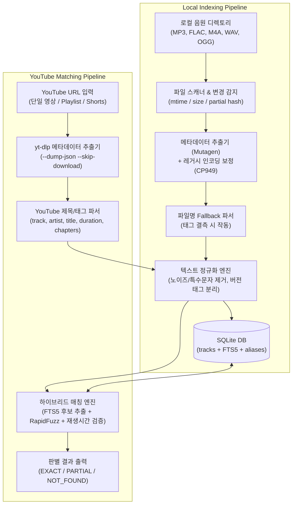

# [초안] TRD: 로컬 음원 기반 YouTube 곡 보유 여부 판별 시스템

- **문서 버전**: v0.3.0
- **작성일**: 2026-10-20
- **관련 문서**: `PRD_mp3_playlist_check.md`, `Change_log.md`

---

## 1. 시스템 아키텍처 (System Architecture)

시스템은 크게 **1) 로컬 인덱싱 파이프라인(Local Indexing Pipeline)**과 **2) YouTube 매칭 파이프라인(YouTube Matching Pipeline)** 두 축으로 동작한다.



---

## 2. 기술 스택 선정 (Technology Stack)

| 영역 | 기술 / 라이브러리 | 선정 사유 |
| :--- | :--- | :--- |
| **언어 / 런타임** | **Python 3.11+** | 오디오 태그 처리, `yt-dlp` 네이티브 연동, 텍스트 유사도 생태계 최강 |
| **데이터베이스** | **SQLite 3 (with FTS5)** | 서버리스 단일 파일 DB, 로컬 수만 곡 규모에서 밀리초(ms) 단위 전문 검색 지원 |
| **오디오 메타데이터** | **`mutagen`** | MP3(ID3v1/v2), FLAC, M4A(MP4), OGG(Vorbis), WAV 태그 및 커버 아트 바이너리 헤더 파싱 표준 |
| **인코딩 복구** | **`chardet`** (또는 CP949 디코딩 체인) | 구형 MP3의 Latin-1로 잘못 래핑된 EUC-KR/CP949 한글 깨짐 자동 복원 |
| **YouTube 파싱** | **`yt-dlp` (Python API)** | API Key 할당량 제한 없이 영상 제목, 챕터, 공식 음원 크레딧(`artist`, `track`), 재생시간 추출 |
| **문자열 유사도** | **`rapidfuzz`** | C++ 기반 고속 유사도 연산 (Token Sort Ratio, Partial Ratio 등 지원) |
| **인터페이스** | **GUI (`tkinter` / `ttk`) + CLI (`typer` + `rich`)** | 원클릭 데스크톱 네이티브 GUI 앱(`run_gui.bat`) 및 자동화용 고속 CLI 인터페이스 동시 지원 |

---

## 3. 데이터베이스 상세 설계 (Database Schema)

단순 6개 기본 항목을 넘어 **증분 스캔, 음질 비교, 정규화 검색, 별칭 매칭**을 수용하는 스키마로 설계한다.

### 3.1 `tracks` (메인 음원 테이블)

```sql
CREATE TABLE IF NOT EXISTS tracks (
    id INTEGER PRIMARY KEY AUTOINCREMENT,
    
    -- 1. 파일 시스템 및 동기화 관리 항목
    file_path TEXT NOT NULL UNIQUE,          -- 파일 절대 경로
    file_name TEXT NOT NULL,                 -- 확장자 포함 파일명
    file_ext TEXT NOT NULL,                  -- 포맷 (mp3, flac, m4a 등)
    file_size INTEGER NOT NULL,              -- 바이트 단위 크기
    mtime REAL NOT NULL,                     -- 파일 최종 수정 시간 (증분 스캔용)
    partial_hash TEXT NOT NULL,              -- 파일 앞/뒤 64KB + 파일크기 SHA256 (파일 이동 감지용)
    is_missing INTEGER DEFAULT 0,            -- 삭제/이동 유실 여부 (0: 정상, 1: 유실)
    tag_source TEXT DEFAULT 'ID3',           -- 메타데이터 출처 ('ID3', 'FILENAME_FALLBACK', 'MIXED')

    -- 2. 원본 음악 메타데이터 (사용자 요청 필수 항목)
    artist TEXT,                             -- 가수 (원본 태그)
    album_artist TEXT,                       -- 앨범 아티스트
    title TEXT,                              -- 노래 제목 (원본 태그)
    album TEXT,                              -- 앨범명
    release_year INTEGER,                    -- 앨범 발매년도 (YYYY)
    track_number INTEGER,                    -- 트랙 넘버
    disc_number INTEGER DEFAULT 1,           -- 디스크 넘버
    genre TEXT,                              -- 장르

    -- 3. 앨범 썸네일(커버 아트) 관리 항목
    has_cover_art INTEGER NOT NULL DEFAULT 0,-- 썸네일 유무 (0: 없음, 1: 내장됨, 2: 폴더 내 cover.jpg 존재)
    cover_mime TEXT,                         -- image/jpeg, image/png
    cover_width INTEGER,                     -- 썸네일 가로 픽셀 (저화질 썸네일 식별용)
    cover_height INTEGER,                    -- 썸네일 세로 픽셀

    -- 4. 오디오 스펙 및 매칭 검증 항목
    duration_sec REAL NOT NULL,              -- 재생 시간(초) - YouTube 길이 대조 핵심 필드
    bitrate_kbps INTEGER,                    -- 비트레이트 (음질 판별)
    sample_rate_hz INTEGER,                  -- 샘플링 레이트

    -- 5. 검색 및 매칭용 정규화 필드
    norm_artist TEXT NOT NULL,               -- 정규화된 가수명 (소문자, 공백/특수문자 제거)
    norm_title TEXT NOT NULL,                -- 정규화된 곡명 (피처링/괄호 제거 후 순수 곡명)
    feat_artists TEXT,                       -- 분리 추출된 피처링 아티스트 목록 (JSON/CSV)
    version_tag TEXT DEFAULT 'studio',       -- 버전 구분 ('studio', 'live', 'inst', 'remix', 'acoustic')

    created_at DATETIME DEFAULT CURRENT_TIMESTAMP,
    updated_at DATETIME DEFAULT CURRENT_TIMESTAMP
);

CREATE INDEX idx_tracks_norm_title ON tracks(norm_title);
CREATE INDEX idx_tracks_norm_artist ON tracks(norm_artist);
CREATE INDEX idx_tracks_partial_hash ON tracks(partial_hash);
CREATE INDEX idx_tracks_has_cover ON tracks(has_cover_art);
```

### 3.2 `tracks_fts` (SQLite FTS5 전문 검색 가상 테이블)

수만 곡 중 퍼지 매칭(RapidFuzz) 대상을 수십 건 이내로 빠르게 좁히기(Candidate Filtering) 위해 FTS5 인덱스를 사용한다.

```sql
CREATE VIRTUAL TABLE IF NOT EXISTS tracks_fts USING fts5(
    artist,
    title,
    norm_artist,
    norm_title,
    album,
    content='tracks',
    content_rowid='id',
    tokenize='unicode61'
);

CREATE TRIGGER IF NOT EXISTS tracks_ai AFTER INSERT ON tracks BEGIN
    INSERT INTO tracks_fts(rowid, artist, title, norm_artist, norm_title, album)
    VALUES (new.id, new.artist, new.title, new.norm_artist, new.norm_title, new.album);
END;

CREATE TRIGGER IF NOT EXISTS tracks_ad AFTER DELETE ON tracks BEGIN
    INSERT INTO tracks_fts(tracks_fts, rowid, artist, title, norm_artist, norm_title, album)
    VALUES ('delete', old.id, old.artist, old.title, old.norm_artist, old.norm_title, old.album);
END;

CREATE TRIGGER IF NOT EXISTS tracks_au AFTER UPDATE ON tracks BEGIN
    INSERT INTO tracks_fts(tracks_fts, rowid, artist, title, norm_artist, norm_title, album)
    VALUES ('delete', old.id, old.artist, old.title, old.norm_artist, old.norm_title, old.album);
    INSERT INTO tracks_fts(rowid, artist, title, norm_artist, norm_title, album)
    VALUES (new.id, new.artist, new.title, new.norm_artist, new.norm_title, new.album);
END;
```

### 3.3 `artist_aliases` (아티스트 한/영 및 이명 매핑 테이블)

```sql
CREATE TABLE IF NOT EXISTS artist_aliases (
    id INTEGER PRIMARY KEY AUTOINCREMENT,
    canonical_norm_artist TEXT NOT NULL,     -- 대표 정규화 아티스트명 (예: '아이유')
    alias_norm_artist TEXT NOT NULL UNIQUE   -- 별칭 (예: 'iu', '이지은')
);
```

### 3.4 `youtube_cache` (YouTube URL 조회 캐시 테이블)

동일 링크 재조회 시 네트워크 지연을 없애고 `yt-dlp` 호출 횟수를 최소화한다.

```sql
CREATE TABLE IF NOT EXISTS youtube_cache (
    video_id TEXT PRIMARY KEY,               -- YouTube 11자리 Video ID
    raw_title TEXT NOT NULL,
    uploader TEXT,
    yt_artist TEXT,                          -- YouTube Music 메타데이터상 artist
    yt_track TEXT,                           -- YouTube Music 메타데이터상 track
    duration_sec REAL,
    chapters_json TEXT,                      -- 챕터 목록 (모음집 영상일 경우)
    fetched_at DATETIME DEFAULT CURRENT_TIMESTAMP
);
```

---

## 4. 핵심 모듈 상세 설계 (Core Module Specifications)

### 4.1 모듈 1: 로컬 음원 스캐너 & 인코딩 복구기 (`ScannerModule`)

1. **증분 스캔 (Incremental Scan)**:
   - 파일의 `(file_path, mtime, file_size)`가 DB 레코드와 일치하면 태그 파싱을 건너뛴다.
   - 경로는 바뀌었으나 `partial_hash`(파일 시작 64KB + 끝 64KB + 파일 크기 해시)가 동일한 레코드가 있으면 **파일 이동(Move)**으로 간주하고 `file_path`만 업데이트한다.
2. **한글 깨짐 복구 (Mojibake Recovery)**:
   - 구형 MP3 ID3v1/v2 태그에서 CP949 바이트가 `latin-1`로 잘못 읽힌 경우(`b = text.encode('latin-1') -> b.decode('cp949')`)를 감지·복원한다.
3. **파일명 Fallback 파서**:
   - 태그의 `title`이 비어 있는 경우, 파일명에서 트랙번호와 가수명을 정규식(`^(?:\d+[\.\-\s]+)?(?P<artist>.+?)\s*[-_]\s*(?P<title>.+)$`)으로 분리 추출하고 `tag_source = 'FILENAME_FALLBACK'`으로 기록한다.
4. **썸네일 감지**:
   - 내장 태그: MP3 `APIC` 프레임, FLAC `pictures`, M4A `covr` 태그 유무 및 이미지 헤더(Width/Height) 파싱.
   - 외부 이미지: 내장 태그가 없더라도 동일 폴더 내 `cover.jpg`, `folder.jpg`, `front.png` 존재 시 `has_cover_art = 2`로 기록.

---

### 4.2 모듈 2: 텍스트 정규화 파이프라인 (`NormalizerModule`)

로컬 음원과 YouTube 제목 모두 동일한 정규화 함수를 통과시켜 비교 기준을 통일한다.

1. **YouTube 노이즈 토큰 제거 정규식**:
   - 대괄호/소괄호 내 노이즈 제거: `(?i)[\[\(]\s*(mv|m/v|official\s*(music\s*)?video|official\s*audio|lyrics?|가사|4k|hd|remastered|티저|teaser|live\s*clip|선공개|풀버전).*?[\]\)]`
   - 불필요 접미사 제거: `(?i)\s*(official\s*video|official\s*audio|lyric\s*video|visualizer)\s*$`
2. **버전 키워드 분리 (`version_tag`)**:
   - 제목에서 제거하기 전에 `live`, `inst`, `instrumental`, `mr`, `remix`, `acoustic`, `cover`, `커버` 키워드 존재 여부를 먼저 추출하여 `version_tag`에 저장한다.
3. **피처링(`feat.`) 분리**:
   - `(?i)[\(\[]?\s*(?:feat\.?|ft\.?|prod\.?\s*by|with)\s+([^\)\]]+)[\)\]]?` 패턴을 추출하여 `feat_artists`에 별도 보관하고, 본 제목(`norm_title`)에서는 제거하여 제목 매칭 순도를 높인다.
4. **최종 정규화 (`norm_title`, `norm_artist`)**:
   - 유니코드 NFKC 정규화 → 영문 소문자 변환 → 문장부호/특수문자/공백 제거.
   - 예: `"Good Day (좋은 날) (Feat. 홍길동)"` → `norm_title`: `"goodday좋은날"`, `feat`: `"홍길동"`

---

### 4.3 모듈 3: YouTube 메타데이터 수집기 (`YouTubeExtractor`)

- **`yt-dlp` Python 내장 호출 옵션**:
  ```python
  ydl_opts = {
      "quiet": True,
      "no_warnings": True,
      "skip_download": True,
      "extract_flat": "in_playlist",  # 플레이리스트일 경우 고속 추출
  }
  ```
- **추출 우선순위**:
  1. **공식 음원 메타데이터 (`info.get('track')`, `info.get('artist')`)**: YouTube Music 자동 생성 영상(Topic 채널)이거나 음원 권리자가 등록한 영상은 정확한 곡명과 아티스트가 별도 필드로 제공됨 (신뢰도 최상).
  2. **영상 제목 (`info.get('title')`) + 채널명 (`info.get('uploader')` / `info.get('channel')`)**:
     - 채널명에서 ` - Topic`, `Official` 등을 제거한 값을 후보 아티스트로 활용.
     - 제목이 `A - B` 구조일 때 `A`와 `B` 양방향(가수-제목 / 제목-가수) 모두 후보로 생성.
  3. **챕터 정보 (`info.get('chapters')`)**:
     - 영상 길이가 600초(10분) 이상이고 `chapters` 배열이 존재하면, 각 챕터의 `title`과 `end_time - start_time`(개별 곡 길이)을 분리하여 다중 곡 매칭 모드로 전환.

---

### 4.4 모듈 4: 하이브리드 매칭 & 스코어링 엔진 (`MatcherEngine`)

단순 일치 검사가 아닌 **가중치 기반 종합 신뢰도 점수(Confidence Score, 0~100점)**를 계산한다.

#### Step 1: 후보군 필터링 (Candidate Retrieval)
- SQLite `tracks_fts` 전문 검색 후보와 함께, 공백 제거·한영 병기(`좋은날(Good Day)`) 부분 문자열 누락을 방지하기 위해 활성 트랙(`is_missing = 0`)의 `(id, norm_artist, norm_title, artist, title)`에 대해 RapidFuzz 고속 프리필터링을 병행하여 상위 50개 후보 트랙을 추출.

#### Step 2: 정량 스코어 산출 수식
각 후보 트랙에 대해 다음 점수를 계산한다:

$$S_{\text{total}} = (0.55 \times S_{\text{title}}) + (0.30 \times S_{\text{artist}}) + (0.15 \times S_{\text{duration}}) - P_{\text{version}}$$

1. **제목 유사도 ($S_{\text{title}}$, 0~100)**:
   - `norm_title` 간 Exact Match 시 `100점`.
   - 한쪽이 한영 병기(`좋은날(Good Day)`)이고 다른 쪽이 단일 언어(`좋은 날` 또는 `Good Day`)인 경우 괄호 안팎 토큰 중 최대 유사도(`rapidfuzz.fuzz.token_set_ratio` / 부분 토큰 일치) 적용.
2. **아티스트 유사도 ($S_{\text{artist}}$, 0~100)**:
   - `artist_aliases` 테이블을 통해 표준화된 아티스트명 일치 시 `100점`.
   - YouTube 제목이나 업로더 채널명에 로컬 `norm_artist`가 포함되어 있으면 `90~100점`.
3. **재생시간 일치도 ($S_{\text{duration}}$, 0~100)**:
   - 오차 $\Delta t = |T_{\text{youtube}} - T_{\text{local}}|$
   - $\Delta t \le 5\text{초}$: `100점`
   - $5\text{초} < \Delta t \le 15\text{초}$ (MV 인트로/아웃트로 감안): `80점`
   - $15\text{초} < \Delta t \le 35\text{초}$: `50점`
   - $\Delta t > 35\text{초}$ (티저, Shorts, 1시간 반복 영상 등): `0점` (단, MV 드라마 버전 예외 플래그 표시)
4. **버전 불일치 페널티 ($P_{\text{version}}$)**:
   - YouTube 영상과 로컬 음원의 `version_tag`(`studio` vs `live`/`inst`/`remix`/`cover`)가 서로 다를 경우 **`-20점` 페널티** 부여 및 상태 강등.

#### Step 3: 최종 판별 기준 (Decision Threshold)

| 판별 등급 | 조건 | 사용자 안내 메시지 |
| :--- | :--- | :--- |
| **`EXACT_MATCH` (보유)** | $S_{\text{total}} \ge 85$ 이고 $P_{\text{version}} = 0$ 이며 $S_{\text{duration}} \ge 80$ ($\Delta t \le 15\text{초}$) | "보유 중인 곡입니다." (파일 경로 및 스펙 출력) |
| **`PARTIAL_MATCH` (유사/버전 상이)** | $70 \le S_{\text{total}} < 85$ 또는 ($S_{\text{total}} \ge 85$ 이나 $P_{\text{version}} > 0$ 또는 $S_{\text{duration}} < 80$) | "동일/유사 곡이 있으나 버전(Live/Inst 등) 또는 재생시간이 다릅니다." |
| **`NOT_FOUND` (미보유)** | $S_{\text{total}} < 70$ | "로컬 라이브러리에 없는 곡입니다." |

---

## 5. 예외 처리 및 엣지 케이스 대응 (Edge Cases & Mitigations)

1. **YouTube 제목이 `제목 - 가수` 순서이거나 곡명만 있는 경우**
   - `A - B` 분리 시 `(Artist=A, Title=B)` 조합과 `(Artist=B, Title=A)` 조합을 모두 계산하여 더 높은 $S_{\text{total}}$ 점수를 채택한다.
   - 제목에 가수명이 전혀 없는 경우 YouTube 채널명(`uploader`)과 설명란(`description`) 하단의 `Provided to YouTube by ...` 자동 생성 텍스트에서 아티스트를 추출한다.
2. **동일 곡이 로컬에 여러 파일(예: MP3와 FLAC, 또는 베스트 앨범 중복)로 존재하는 경우**
   - 매칭된 모든 로컬 파일 목록을 반환하되, 무손실 포맷(`FLAC` > `WAV` > `M4A/MP3` 고비트레이트 순) 및 썸네일 보유 파일을 최상단 대표 결과로 표시한다.
3. **손상된 오디오 파일 (Corrupted Files)**
   - 스캔 도중 헤더 손상으로 `mutagen` 파싱 에러 발생 시 스캔 프로세스를 중단하지 않고 `scan_errors` 로그에 기록한 뒤 다음 파일로 진행한다.

---

## 6. 프로젝트 디렉토리 구조 (권장안)

```text
mp3_playlist_check/
├── pyproject.toml
├── README.md
├── Change_log.md                 # 버전별(v0.1.0 ~ v0.3.0) 상세 변경 이력
├── run_gui.bat                   # 윈도우 탐색기 더블클릭 GUI 실행 배치 파일
├── PRD_mp3_playlist_check.md
├── TRD_mp3_playlist_check.md
├── data/
│   ├── music_library.db          # SQLite DB 파일
│   └── settings.json             # GUI 환경 설정 (마지막 스캔 폴더 등)
├── src/
│   ├── __init__.py
│   ├── config.py                 # 절대 경로(PROJECT_ROOT), 허용 오차, 임계값 설정
│   ├── db/
│   │   ├── __init__.py
│   │   ├── schema.sql            # 테이블, FTS5 및 동기화 트리거 DDL
│   │   └── repository.py         # SQLite CRUD, 별칭 캐시, 하이브리드 검색, 중복 클러스터링 및 영구 삭제
│   ├── scanner/
│   │   ├── __init__.py
│   │   ├── file_walker.py        # 재귀 폴더 탐색, 인메모리 증분 스캔, 단일 파일 동기화
│   │   ├── tag_extractor.py      # mutagen 파싱, 커버아트 해상도 확인, CP949 복구
│   │   ├── fallback_parser.py    # 파일명/경로 기반 태그 추론
│   │   ├── cover_manager.py      # 앨범 커버아트 바이너리 추출, iTunes API 검색 및 태그 내장
│   │   └── tag_normalizer.py     # 태그 파일 반영 및 '가수 - 제목' 표준 파일명 일괄 변경
│   ├── youtube/
│   │   ├── __init__.py
│   │   └── extractor.py          # yt-dlp 래퍼(단일/플레이리스트/챕터) 및 캐싱 처리
│   ├── matcher/
│   │   ├── __init__.py
│   │   ├── normalizer.py         # 정규식 노이즈 제거, 버전/피처링 분리 및 토큰 정규화
│   │   └── scorer.py             # 가중치 스코어링 및 3단계 판별 엔진
│   ├── cli.py                    # Typer/Rich 기반 CLI 명령어 인터페이스
│   └── gui.py                    # Tkinter/TTK 기반 4-탭 네이티브 데스크톱 GUI (중복 관리/커버/태그 작업 지원)
└── tests/
    ├── test_normalizer.py
    ├── test_matcher.py
    ├── test_scanner_and_db.py
    ├── test_youtube.py
    ├── test_gui_and_cli.py
    └── test_v030_features.py     # v0.3.0 신규 기능 통합 검증 (커버/태그/중복/CSV)
```

---

## 7. 검증 및 테스트 계획 (Verification Criteria)

1. **단위 테스트 (`pytest`)**:
   - 정규화 테스트: `[MV] 아이유(IU) - 좋은 날 (Good Day) (Official Video)` → `artist: 아이유/iu`, `title: 좋은날/goodday` 분리 검증.
   - 버전 감지 테스트: `아이유 - 좋은 날 (Live ver.)` 입력 시 로컬 Studio 원곡과 대조하여 `PARTIAL_MATCH` 반환 여부 확인.
   - 재생시간 필터 테스트: 30초 Shorts 영상 입력 시 로컬 원곡(3분 50초)과 대조하여 오탐(`EXACT_MATCH`) 방지 확인.
   - 커버아트 추출/내장 테스트: MP3/FLAC/M4A 커버아트 추출 및 임베딩, 로컬 앨범 공유 및 iTunes API 모의 검증.
   - 태그 반영 및 파일명 표준화 테스트: 메타데이터 태그 저장 및 파일명 변경, 파일 충돌 방지 검증.
   - 중복 클러스터링 및 삭제 테스트: 카노니컬 별칭/피처링 분리 기반 중복 묶음, 품질 기반 정렬, 삭제 및 안전 가드 검증.
   - CSV 인코딩 테스트: Excel 한글 호환을 위한 UTF-8 with BOM(`utf-8-sig`) 무결성 검증.
2. **통합 테스트**:
   - 샘플 음원 폴더(정상 태그, 태그 누락, EUC-KR 깨진 태그, FLAC/MP3 혼합) 스캔 후 DB 적재 무결성 및 썸네일 유무 정확도 100% 검증.
